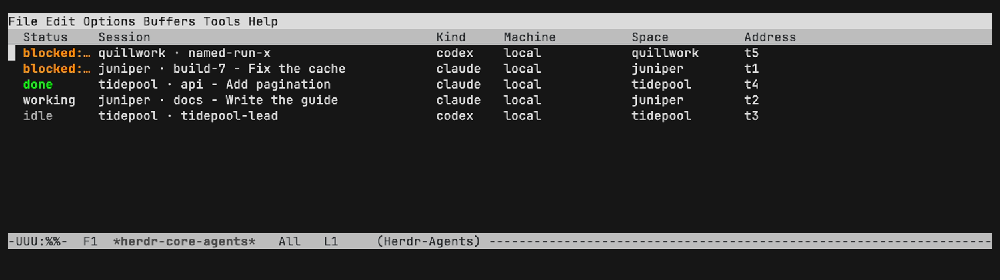

#+title: herdr-core.el

See every coding agent on every machine in one Emacs list, sorted by who is blocked on you, and jump into any of them.

Emacs client for [[https://herdr.dev/core/][herdr-core]] (=hc=): every agent on every machine the
core reaches, with every behavior customizable. Talks only to =hc= (=hc
events/ls/get/read/send/run/attach/wait/keys/interrupt/put/label/kill
--json=; =hc schema= is its OpenRPC spec).

* License and attribution

GPL-3.0-or-later (see LICENSE). Derived from
[[https://github.com/baongoc124/emacs-herdr][emacs-herdr]] by Ngoc Nguyen
(Copyright (C) 2026 Ngoc Nguyen, GPL-3.0), ported to talk to =hc= instead of
the herdr TUI and extended by David Awad. Copyright (C) 2026 Ngoc Nguyen,
David Awad.

* Install

#+begin_src sh
git clone https://github.com/davidawad/herdr-core.el ~/code/herdr-core.el
#+end_src

Needs Emacs 30.1+, =transient= (built in), [[https://github.com/d12frosted/vui.el][vui.el]] (MELPA), [[https://github.com/davidawad/vuistack-table][vuistack-table]]
(a TanStack-style table component for vui; the agent list is one) and =hc= on
=PATH= (or =herdr-core-executable=). Attach buffers use [[https://github.com/dakra/ghostel][Ghostel]] when it is installed,
else =term=.

#+begin_src emacs-lisp
(use-package herdr-core
  :load-path "~/code/herdr-core.el"
  :commands (herdr-core-agents herdr-core-switch-agent herdr-core-menu)
  :custom
  (herdr-core-menu-key "C-9")            ; the transient menu, also inside Ghostel
  (herdr-core-keymap-prefix "C-c h")     ; `herdr-core-command-map'
  (herdr-core-group-by 'machine)
  :config
  (herdr-core-mode 1))                   ; event stream, mode-line count, notifications
#+end_src

* What it does

An agent is an hc terminal; its status is the OSC 7501 record its harness
reports (idle, working, done, blocked with its kind -- permission, question,
auth -- or error). Machines are this host (=local=), ssh machines and pod
machines (=hc machine add=, a pod's machine name such as =pod-x-a1=); an address is =t3= here
or =orion/t3= there.

| Feature | Commands | Covered by (test/) |
|-
| Live agent list from =hc events=, every machine | =herdr-core-agents= | =herdr-core-agents-list-buffer-and-keys=, =herdr-core-live-pod-agent-in-the-list-and-picker= |
| The list is a vuistack-table: customizable columns, multi-sort (attention by default), grouping with attention counts (machine/space/tab/kind/status/label/function) | =S=, =C-u S=, =G=, =x= in the list | =herdr-core-list-columns-sorting-and-grouping=, =herdr-core-list-table-grouping-and-aggregation= |
| Narrowing as column filters, global and fuzzy filters, marks as the table's selection, several marked side by side | =/ m=, =/ s=, =/ t=, =/ f=, =f=, =/ /=, =m=, =u=, =v= | =herdr-core-list-narrow-mark-and-keys=, =herdr-core-list-table-filters= |
| Row actions and live updates that keep the table's sort, filters and selection | =RET=, mouse-1, =a=, =o=, =r= | =herdr-core-list-table-row-actions=, =herdr-core-list-table-keeps-state-across-events= |
| Attention-sorted picker, completion groups, pluggable reader | =herdr-core-switch-agent=, =herdr-core-attach-agent=, =herdr-core-observe-agent= | =herdr-core-picker-groups-and-custom-reader=, =herdr-core-switch-attach-observe-read-goto-blocked= |
| Next/previous/last, jump to blocked, next needing attention | =herdr-core-next-agent=, =herdr-core-previous-agent=, =herdr-core-last-agent=, =herdr-core-goto-blocked=, =herdr-core-next-attention= | =herdr-core-next-previous-attention-and-scope= |
| Switch by machine, space, tab; attach any terminal | =herdr-core-switch-machine=, =herdr-core-switch-space=, =herdr-core-switch-tab=, =herdr-core-attach-terminal= | =herdr-core-switch-machine-space-tab-and-any-terminal= |
| Ghostel attach buffers, several side by side (columns/rows/grid/function) | =herdr-core-attach-several=, =herdr-core-attach-group= | =herdr-core-side-by-side-layouts=, =herdr-core-attach-history-hook-and-display-actions= |
| Read buffers rendering links, files, images, diffs (pluggable renderers) | =herdr-core-read-agent= | =herdr-core-read-renders-links-files-images-and-diffs=, =herdr-core-read-remote-files-and-images-go-through-hc=, =herdr-core-read-follows-the-agent= |
| Session names from labels (session.title, herdr.space, herdr.tab) | buffer names, =herdr-core-rename-agent= | =herdr-core-buffers-are-named-by-the-session-title= (the session-name golden table), =herdr-core-attach-buffers-follow-the-session-title= |
| Control layout: the list on the left, the agent under its cursor on the right (attached, watched or read), switching as the cursor rests; TAB goes into it | =herdr-core-control=, =herdr-core-follow-mode=, =herdr-core-follow-focus= | =herdr-core-follow-shows-the-row-agent-in-the-follow-window=, =herdr-core-follow-schedule-debounces= |
| Mode-line count and notifications | =herdr-core-mode= | =herdr-core-mode-line-notify-and-reconnect=, =herdr-core-notify-and-mode-line-options= |
| Push events, poll fallback or poll only | =herdr-core-reconnect=, =herdr-core-poll= | =herdr-core-poll-policy-and-poll-fallback=, =herdr-core-event-hooks-and-machine-refresh= |
| Send region, keys, interrupt, put a file, wait, rename, kill, schema | =herdr-core-send-region=, =herdr-core-submit-region=, =herdr-core-send-keys=, =herdr-core-interrupt-agent=, =herdr-core-put-file=, =herdr-core-wait-agent=, =herdr-core-rename-agent=, =herdr-core-kill-agent=, =herdr-core-schema= | =herdr-core-send-region-and-submit=, =herdr-core-talk-commands-go-through-hc= |
| Start an agent through a customizable launcher (default =hc run=, labelled) | =herdr-core-new-agent= (C-u: pick the machine) | =herdr-core-new-agent-goes-through-the-one-launcher=, =herdr-core-launcher-template-machine-and-hooks= |
| hc's own picker in a buffer | =herdr-core=, =herdr-core-hide=, =herdr-core-toggle= | =herdr-core-picker-buffer-runs-hc= |
| Keymap and transient menu | =herdr-core-command-map=, =herdr-core-menu= | =herdr-core-keymap-prefix-and-menu-suffixes=, =herdr-core-menu-builds-its-suffixes= |
| Backend command, args, environment, starting the core | | =herdr-core-backend-args-and-environment=, =herdr-core-picker-offers-to-start-the-core= |
| Against a real core: launch with labels and keep, send, read and render, wait, rename, pod machine kind, OpenRPC schema | | =herdr-core-live-launch-read-render-send-and-machines= |
| Every option grouped and documented here | | =herdr-core-every-option-is-grouped-and-documented= |

** The agent list (=herdr-core-agents=)

The list is a [[https://github.com/d12frosted/vui.el][vui]] buffer holding one vuistack-table:
the columns of =herdr-core-list-columns= (each may carry vuistack-table column
keys), sorted by default by attention then most recent change (a multi-sort:
the headings show =Status ▲1=-style marks only for shown columns), grouped by
=herdr-core-group-by= on a group column whose rows read
=herdr-core-group-header-function=, the agent count and, in the status column,
a glyph and count per attention status. Sort, filters, grouping, folded groups,
the marks (the table's row selection) and the page are the table's state: an hc
event re-renders the table and keeps them, and point stays on its agent.

=RET=/mouse-1 show (the table's row action), =a= attach (C-u: afresh), =o=
watch, =r= read, =s= send a line, =b= next blocked, =S= sort by a column (again:
reverse; C-u adds it to the multi-sort; "attention" restores the default), =G=
group, =/ m= =/ s= =/ t= narrow to a machine, space or tab (an exact column
filter, shown after the headings), =/ f= filter every column (=~text= is fuzzy,
=Column: text= one column) and =/ /= drops the narrowing and every filter,
=m=/=u= mark and =v= show the marked side by side, =i= interrupt, =e= rename,
=k= kill, =c= new agent, =?= the menu, =g= reconnect, =n=/=p= next and previous
agent. The table's own keys work too: =f= filter the column at point (its
values offered with counts), =F= clear filters, =x=/=X= fold a group / all,
=M=/=U= select all / none, =H=/=V= hide / show columns (=V= also shows the
hidden attention, changed, machine, space and tab columns), =<= =>= move, =|=
pin, =+= =-= =\== width, =]= =[= =#= pages, =T=/=B= pin a row, =c= is new agent
here, =C= =w= cell ranges and copy, =C-c C-r= reset, =C-c C-d= the table's state.
The keymap is =herdr-core-agents-mode-map= (its parent holds
=vuistack-table-mode-map=); =herdr-core-agents-mode-hook= runs in the buffer.

** Read buffers (=herdr-core-read-agent=)

=hc read --lines N=, then each of =herdr-core-renderers= over the text:
=herdr-core-render-ansi= (colors), =herdr-core-render-diffs= (diff faces; =d=
opens the diff at point in =diff-mode=), =herdr-core-render-links= (URL
buttons), =herdr-core-render-images= (images shown below their line; on other
machines fetched with =hc exec --on M base64= per
=herdr-core-render-remote-images=), =herdr-core-render-files= (file buttons;
here existing files, elsewhere absolute paths opened through =hc file read
--on M=). A renderer is any function of =(BEG END AGENT)=. Keys
(=herdr-core-read-mode-map=): =g= read again, =f= toggle following (reading
again when the agent's turn or status moves), =a= attach, =s= send, =TAB= next
button.

** The launcher

=herdr-core-new-agent= runs =herdr-core-launcher= with =herdr-core-launcher-args=,
a template (=%n= name, =%d= directory, =%k= harness, =%m= machine, =%s= space,
=%t= tab; a function element returns arguments, as =herdr-core-launch-on-args=
gives =--on MACHINE=). The default is plain hc, =herdr-core-launcher= ="hc"= with
=herdr-core-hc-run-launcher-args=:

#+begin_src emacs-lisp
;; hc run --bg --keep --outlive-parent --no-parent --json --name N --cwd D [--on M]
;;   --label herdr.space=S --label herdr.tab=T --label session.title="S · T" -- KIND
#+end_src

The labels put the agent in the Herdr app's spaces and tabs. A launcher script of
your own (one that adds roles or sandboxes, say) goes in its place:

#+begin_src emacs-lisp
(setopt herdr-core-launcher "my-agent-launcher"
        herdr-core-launcher-args '("run" "--name" "%n" "--cwd" "%d" "--" "%k"))
#+end_src

Or replace the whole step with =herdr-core-launch-function=, a function of
=(SPEC CALLBACK)=.

** Display actions and layouts

Each context (=attach=, =observe=, =switch=, =launch=, =picker=, =list=, =read=,
=show=) has its =display-buffer= action in =herdr-core-display-actions=.
=herdr-core-attach-several=, =herdr-core-attach-group= and =v= in the list lay
agents out per =herdr-core-layout= (=columns=, =rows=, =grid= or a function;
=herdr-core-attach-in-window= helps write one), at most =herdr-core-layout-max=.

* Options

Every behavior is an option or hook, one customize group per area under
=M-x customize-group RET herdr-core=.

** =herdr-core-backend=: How herdr-core runs hc.

| Option | Default | What it does |
|-
| =herdr-core-executable= | ~"hc"~ | The herdr-core CLI. |
| =herdr-core-executable-args= | ~nil~ | Arguments put before every hc command. With =herdr-core-executable= "ssh" and this ("box" "hc"), every call goes to box's hc. |
| =herdr-core-process-environment= | ~nil~ | Extra VAR=VALUE entries in the environment of every hc process. |
| =herdr-core-start-core= | ~ask~ | What to do when the hc core is not running and a command needs it. |

** =herdr-core-events=: How herdr-core learns about changes: the hc event stream, or polling.

| Option | Default | What it does |
|-
| =herdr-core-refresh-policy= | ~events~ | How the agent state is kept current. =events=: follow =hc events --json= (pushed), restarting it when it ends. =events+poll=: the same, and poll =hc ls= while the stream is down. =poll=: only poll =hc ls --json= every =herdr-core-poll-interval= seconds. |
| =herdr-core-poll-interval= | ~10~ | Seconds between polls of =hc ls= (see =herdr-core-refresh-policy=). |
| =herdr-core-poll-details= | ~t~ | Non-nil completes each polled terminal with =hc get= (blocked kind, labels). Nil polls only =hc ls=, one call however many terminals there are. |
| =herdr-core-reconnect-delay= | ~5~ | Seconds before a dropped event stream is started again. |
| =herdr-core-refresh-delay= | ~0.2~ | Seconds to gather a burst of events into one redraw. |
| =herdr-core-snapshot-timeout= | ~2~ | Seconds a picker waits for the stream's snapshot before asking =hc ls=. |
| =herdr-core-event-functions= | ~nil~ | Functions called with each parsed message of the event stream, after it applies. |
| =herdr-core-refresh-hook= | ~nil~ | Hook run after the list buffer, buffer names and mode line are redrawn. |

** =herdr-core-agents=: Which terminals are agents, and what they are called.

| Option | Default | What it does |
|-
| =herdr-core-labelled-only= | ~nil~ | Non-nil shows only terminals with a =herdr-core-space-label= (the Herdr app's). |
| =herdr-core-show-finished= | ~nil~ | Non-nil also shows finished terminals. |
| =herdr-core-hidden-machines= | ~nil~ | Machines whose terminals are never shown ("local" is this host). |
| =herdr-core-filter-functions= | ~nil~ | Predicates on an agent alist; an agent is shown only when all return non-nil. |
| =herdr-core-title-label= | ~"session.title"~ | The label holding a session's one name. |
| =herdr-core-space-label= | ~"herdr.space"~ | The label naming a terminal's space (the Herdr app's sidebar). |
| =herdr-core-tab-label= | ~"herdr.tab"~ | The label naming a terminal's tab within its space. |
| =herdr-core-name-sources= | ~(session tab name address)~ | Where an agent's display name comes from, the first non-empty one. Each is an agent key (session, tab, name, address, kind, space) or a label name string. |
| =herdr-core-name-function= | ~herdr-core-default-name~ | Function of an agent alist returning its display name. |
| =herdr-core-buffer-name-function= | ~herdr-core-default-buffer-name~ | Function of (KIND TITLE) returning a buffer's base name. KIND is nil (attach), "observe" or "read"; TITLE is =herdr-core-title=. |
| =herdr-core-status-glyphs= | ~(("blocked" . "●") ("error" . "✗") ("...~ | Glyph per status, in header lines and the glyph column. |
| =herdr-core-status-priority= | ~(("blocked" . 0) ("error" . 1) ("done...~ | Attention order of statuses: lower comes first. |
| =herdr-core-attention-statuses= | ~("blocked" "error" "done")~ | Statuses =herdr-core-next-attention= stops at. |
| =herdr-core-pod-machine-regexp= | ~"-a[0-9]+\\'"~ | Machine names matching this are pods (a pod's machine name such as pod-x-a1). |
| =herdr-core-machine-kind-function= | ~herdr-core-machine-kind~ | Function of (NAME RECORD) returning a machine's kind string. RECORD is its =hc machine ls= entry or nil; the default gives local, pod, command (a --via machine) or ssh. |

** =herdr-core-list=: The agent list buffer: columns, sorting, grouping.

| Option | Default | What it does |
|-
| =herdr-core-list-columns= | ~(("Status" 9 herdr-core-column-status...~ | Columns of the agent list table: (TITLE WIDTH FUNCTION [PROPS]). FUNCTION gets the agent alist and returns the cell's string. Built in, each =herdr-core-column-= and: status, glyph, name, kind, machine, space, tab, cwd, message, age, address. WIDTH is the column's least width; it grows to its widest cell, up to =vuistack-table-max-auto-width=. PROPS, a plist of vuistack-table column keys (:hidden t, :sort-fn, :aggregation, :action ...), goes into the column spec. |
| =herdr-core-sort-predicate= | ~herdr-core-sort-by-attention~ | Predicate of two agents ordering every list, picker and cycle. In the list table, attention is the default multi-sort (attention, then most recent change) and most recent the change column, sorted descending; any other predicate orders the rows the table starts from. |
| =herdr-core-group-by= | ~nil~ | What the agent list (and picker) groups by. nil: no groups; =machine=, =space=, =tab=, =kind=, =status=; (label KEY): that label; or a function of an agent returning its group name. In the list it is the table's grouping, on a group column of its own. |
| =herdr-core-group-order= | ~first~ | Order of groups: =first= by their first agent (attention), =name= by name. |
| =herdr-core-group-header-function= | ~herdr-core-group-header~ | Function of (GROUP AGENTS) returning the text of a group's row. The table adds the count of agents after it, and the status columns count the agents needing attention. |
| =herdr-core-list-page-size= | ~nil~ | Agents per page of the list table, or nil for one page. |

** =herdr-core-picker=: Picking and switching agents.

| Option | Default | What it does |
|-
| =herdr-core-candidate-function= | ~herdr-core-format-candidate~ | Function of an agent returning its picker candidate string. |
| =herdr-core-picker-group-by= | ~list~ | Completion groups in the picker: =list= follows =herdr-core-group-by=, nil groups nothing, else a value as in =herdr-core-group-by=. |
| =herdr-core-completing-read-function= | ~completing-read~ | The =completing-read= herdr-core uses. |
| =herdr-core-cycle-scope= | ~all~ | What =herdr-core-next-agent= and =herdr-core-previous-agent= cycle through: =all= agents, or those on the current agent's =machine=, =space= or =tab=. |
| =herdr-core-region-format-function= | ~herdr-core-format-region~ | Function of (BEG END) returning the text =herdr-core-send-region= sends. |

** =herdr-core-display=: Attach buffers, display actions and window layouts.

| Option | Default | What it does |
|-
| =herdr-core-terminal-function= | ~herdr-core-terminal~ | Function of (NAME PROGRAM ARGS &optional ACTION) that runs PROGRAM in a terminal buffer NAME, displays it with =display-buffer= ACTION and returns the buffer. |
| =herdr-core-display-actions= | ~((attach (display-buffer-same-window)...~ | =display-buffer= action per context. attach/observe: a picked agent; switch: next/previous/blocked; launch: a new agent; picker: *herdr-core*; list: the agent list; read: read buffers; show: a notification click (never the selected window). |
| =herdr-core-layout= | ~columns~ | How =herdr-core-attach-several= arranges agents side by side: =columns=, =rows=, =grid=, or a function of a list of agents that shows them (and may call =herdr-core-attach-in-window=). |
| =herdr-core-layout-max= | ~4~ | Most agents shown side by side. |
| =herdr-core-layout-delete-other-windows= | ~t~ | Non-nil makes a side-by-side layout fill the frame; nil splits the selected window. |
| =herdr-core-attach-history= | ~0~ | Scrollback lines =hc attach= shows first (its --history). |
| =herdr-core-attach-header-line= | ~t~ | Show a clickable strip of all agents in the header line of attach buffers. Agents are sorted by attention (blocked first); clicking one switches to it. |
| =herdr-core-header-label-width= | ~16~ | Maximum characters per agent label in the attach buffer header line. |
| =herdr-core-header-label-function= | ~herdr-core-header-label~ | Function of an agent returning its header-line label. |
| =herdr-core-attach-hook= | ~nil~ | Hook run in each new attach buffer. |
| =herdr-core-read-lines= | ~500~ | History lines =herdr-core-read-agent= shows above the screen. |
| =herdr-core-wait-timeout= | ~nil~ | Seconds =herdr-core-wait-agent= waits before hc checks in (its --timeout); nil is hc's own default (config =wait_timeout=, else 180). |
| =herdr-core-read-follow= | ~t~ | Non-nil reads an agent again when its turn or status changes. |
| =herdr-core-read-hook= | ~nil~ | Hook run in a read buffer after it is filled and rendered. |

** =herdr-core-render=: Rendering what agents produce in read buffers.

| Option | Default | What it does |
|-
| =herdr-core-renderers= | ~(herdr-core-render-ansi herdr-core-re...~ | Functions of (BEG END AGENT) that decorate a read buffer's text, in order. Built in: =herdr-core-render-ansi=, =herdr-core-render-diffs=, =herdr-core-render-links=, =herdr-core-render-images=, =herdr-core-render-files=. |
| =herdr-core-url-regexp= | ~a regexp, see C-h v~ | URLs =herdr-core-render-links= makes into buttons. |
| =herdr-core-browse-url-function= | ~browse-url~ | Function of a URL that opens it. |
| =herdr-core-file-regexp= | ~a regexp, see C-h v~ | File paths (group 1, optional :LINE in group 2) =herdr-core-render-files= links. On this host only existing files are linked; elsewhere only absolute paths. |
| =herdr-core-image-regexp= | ~a regexp, see C-h v~ | File names =herdr-core-render-images= shows as images. |
| =herdr-core-image-max-width= | ~480~ | Widest an inline image is shown, in pixels. |
| =herdr-core-render-remote-images= | ~click~ | Images on other machines: =click= fetches one when its button is pressed, =inline= fetches each as the buffer renders (=hc exec --on M base64=), nil never. |
| =herdr-core-find-file-function= | ~find-file-other-window~ | Function of a local file name that opens it. |

** =herdr-core-launcher=: Starting new agents.

| Option | Default | What it does |
|-
| =herdr-core-launcher= | ~"hc"~ | The program =herdr-core-new-agent= runs: hc itself, or a launcher script of your own. Its arguments are =herdr-core-launcher-args=. |
| =herdr-core-launcher-args= | =herdr-core-hc-run-launcher-args= | Arguments of =herdr-core-launcher=. In strings, %n is the agent's name, %d its directory, %k its kind (harness), %m its machine, %s its space (the project), %t its tab (the name) and %% a percent sign. A symbol is a function of the spec alist ((?n . NAME) ...) returning a string, a list of strings or nil; =herdr-core-launch-on-args= gives --on MACHINE off this host. The default, =herdr-core-hc-run-launcher-args=, is plain =hc run=. |
| =herdr-core-launch-function= | ~herdr-core-launch-command~ | Function of (SPEC CALLBACK) that starts an agent. SPEC is an alist (name dir kind machine space tab); CALLBACK is called with the new terminal's address, or nil when it failed. |
| =herdr-core-default-agent-kind= | ~"claude"~ | Default harness for =herdr-core-new-agent=. |
| =herdr-core-agent-kinds= | ~("claude" "codex" "pi" "opencode" ...)~ | Harnesses =herdr-core-new-agent= offers. |
| =herdr-core-launch-directory-function= | ~herdr-core-project-directory~ | Function of no arguments returning the directory a new agent starts in. |
| =herdr-core-agent-name-function= | ~herdr-core-default-agent-name~ | Function of (DIRECTORY KIND) returning a new agent's base name. |
| =herdr-core-attach-after-launch= | ~t~ | Non-nil attaches to a new agent once it started. |
| =herdr-core-after-launch-functions= | ~nil~ | Functions called with a new agent's address and the launcher's output. |

** =herdr-core-notify=: Notifications and the mode line.

| Option | Default | What it does |
|-
| =herdr-core-notify-statuses= | ~("blocked" "done" "error")~ | Statuses an agent entering which =herdr-core-notify= reports. |
| =herdr-core-status-change-functions= | ~(herdr-core-notify)~ | Functions run when an agent's status changes in the event stream. Each is called with the agent alist, the old status and the new status. An agent seen for the first time is not a change. |
| =herdr-core-notify-function= | ~herdr-core-system-notify~ | Function of (TITLE BODY ADDRESS) showing a notification. The default is a desktop notification (terminal-notifier, osascript or D-Bus), clicking which shows the agent; =message= is the quiet choice. |
| =herdr-core-notify-when-visible= | ~nil~ | Non-nil notifies even while the agent's buffer is selected in a focused frame. |
| =herdr-core-mode-line-statuses= | ~("blocked")~ | Statuses the mode-line segment counts. |
| =herdr-core-mode-line-format= | ~" ● %d "~ | Format of the mode-line segment, given the count; nothing shows at zero. |
| =herdr-core-mode-line-function= | ~herdr-core-mode-line-segment~ | Function of no arguments returning the mode-line segment string. |
| =herdr-core-mode= | ~nil~ | Non-nil if Herdr-Core mode is enabled. See the =herdr-core-mode= command for a description of this minor mode. Setting this variable directly does not take effect; either customize it (see the info node =Easy Customization=) or call the function =herdr-core-mode=. |
| =herdr-core-mode-hook= | ~nil~ | Hook run after entering or leaving =herdr-core-mode=. No problems result if this variable is not bound. =add-hook= automatically binds it. (This is true for all hook variables.) |

** =herdr-core-control=: The list beside a window that follows its cursor.

| Option | Default | What it does |
|-
| =herdr-core-control-list-width= | ~0.32~ | Width of the list in =herdr-core-control=: a fraction of the frame, or columns. |
| =herdr-core-control-follow= | ~attach~ | What the follow window shows for the agent under the list cursor: =attach= types into it, =observe= watches it, =read= shows its screen and history. Attached buffers are kept, so going back is a swap. |
| =herdr-core-control-debounce= | ~0.2~ | Seconds the list cursor must rest on a row before the follow window changes. |
| =herdr-core-control-follow-functions= | ~nil~ | Called with the agent alist each time the follow window shows a new agent. |
| =herdr-core-follow-mode-hook= | ~nil~ | Hook run after entering or leaving =herdr-core-follow-mode=. |

** =herdr-core-keys=: Keys and the transient menu.

| Option | Default | What it does |
|-
| =herdr-core-menu-repeat-command= | ~herdr-core-agents~ | Command run by pressing =herdr-core-menu-key= again inside the menu. =herdr-core-agents= opens the agent list; =herdr-core-toggle= opens or hides *herdr-core*. |
| =herdr-core-menu-key= | ~nil~ | Global key for =herdr-core-menu=, a =key-valid-p= string such as "C-9". Bound as soon as it is set (independently of =herdr-core-mode=), and also added to =ghostel-keymap-exceptions= so it reaches Emacs from terminal buffers. Pressing it again inside the menu runs =herdr-core-menu-repeat-command=. |
| =herdr-core-keymap-prefix= | ~nil~ | Global prefix key for =herdr-core-command-map=, such as "C-c h". Bound as soon as it is set and let through Ghostel. |
| =herdr-core-menu-suffixes= | ~(("l" "Agent list" herdr-core-agents)...~ | Entries of =herdr-core-menu=: (KEY DESCRIPTION COMMAND). DESCRIPTION is a string or a function returning one. |

** =herdr-core-faces=: Faces of herdr-core.

| Face | Inherits | Used for |
|-
| =herdr-core-status-blocked= | =warning= | Blocked agents (waiting for a person). |
| =herdr-core-status-error= | =warning= | Agents in error. |
| =herdr-core-status-done= | =success= | Agents done with their turn. |
| =herdr-core-status-working= | =default= | Working agents. |
| =herdr-core-status-idle= | =shadow= | Idle agents. |
| =herdr-core-status-unknown= | =shadow= | Terminals that report no status. |
| =herdr-core-group-header= | =bold= | Group rows in the agent list. |
| =herdr-core-mode-line= | =warning= | The mode-line segment. |
| =herdr-core-header-current= | =inverse video= | The current agent in attach-buffer header lines. |
| =herdr-core-link= | =link= | Links and files in read buffers. |

* Tests

ERT, no CI (the repo convention): =make test= runs everything against a fake
=hc= (=test/fixtures/=: an =hc events --json= snapshot of this host, orion,
quasar and a pod, the change lines after it, =hc ls --json=, =hc machine
ls --json=, the session-name golden table), and, when a real =hc= is on =PATH=
(or =HC_BIN=), against scratch cores with short socket paths under =/tmp=.
=make compile= byte-compiles with warnings as errors. Both first run =make
deps=, which clones vui.el and vuistack-table into =.deps/= (git-ignored, not
vendored); set =VUI= or =VUISTACK_TABLE= to directories of your own checkouts
instead, or =VUI_URL=, =VUISTACK_URL= and =VUISTACK_PATH= to fetch them from
elsewhere.
